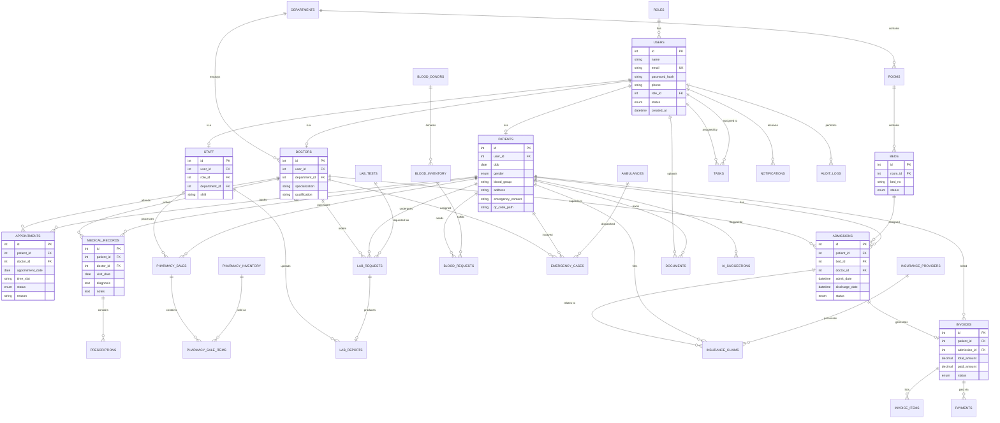

# Entity–Relationship Diagram

Paste this into https://mermaid.live to view visually, or open in VS Code with the "Markdown Preview Mermaid Support" extension.

Full column-level DDL with constraints, indexes and foreign keys is in `backend/database/schema.sql` (30 tables, 3rd normal form: no repeating groups, all non-key attributes fully functionally dependent on primary keys, junction tables used for many-to-many relations such as invoice items and sale items).
